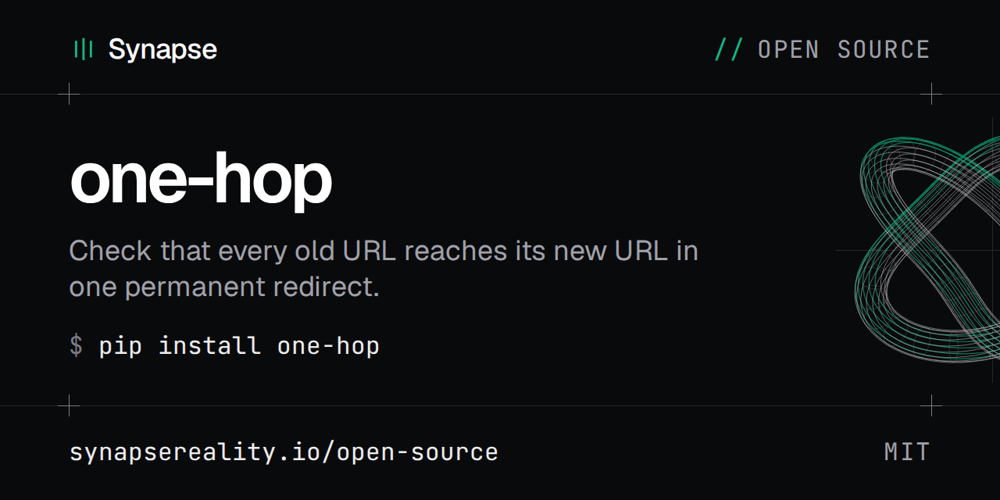

[](https://synapsereality.io/open-source/one-hop/)

[](https://pypi.org/project/one-hop/)
[](https://github.com/synapsereality/one-hop/actions/workflows/ci.yml)
[](https://github.com/synapsereality/one-hop/blob/main/LICENSE)

[Docs](https://synapsereality.io/open-source/one-hop/) |
[synapsereality.io](https://synapsereality.io) |
[Synapse open source](https://synapsereality.io/open-source/) |
[PyPI](https://pypi.org/project/one-hop/)

# one-hop

Checks a redirect map. Every old URL has to answer with one permanent redirect
(301 or 308) straight to its new URL. The new URL has to answer 200. Anything else
fails: a chain, a loop, a 404, a redirect to the wrong page. The exit code is then
1, so CI can stop the release. [Run it in CI](#run-it-in-ci) has jobs for GitHub
Actions, GitLab CI, Bitbucket Pipelines and a plain shell step.

Docs: https://synapsereality.io/open-source/one-hop/

```bash
pip install one-hop
one-hop redirects.csv --base https://example.com
```

## Why one hop

A chain such as `/about-us` to `/about` to `/about/` still loads in a browser, so
nobody spots it. Crawlers do. Google follows up to 10 hops and then gives up, and
every extra hop is one more request per URL. After a migration the map is often
right on paper and wrong on the server. One trailing-slash rule or a leftover
redirect plugin adds a second hop to hundreds of rules at once.

We wrote the first version for our own site move in September 2026, 2,030 rules
from a WordPress site to a static build. This is that script, made general.

## Before the move: snapshot the old URLs

A redirect map is only as good as its list of old URLs. `one-hop snapshot`
records them while the old site is still up, so the map starts from what the
site serves, not from memory.

```bash
one-hop snapshot https://example.com/sitemap.xml --out snapshot.csv
```

It reads the sitemap, following redirects, sitemap indexes and `.gz` files.
`--urls FILE` adds URLs the sitemap leaves out, one per line. Then it fetches
each URL, follows its redirects and writes a row for it. Against a local test
server:

```text
$ one-hop snapshot https://example.com/sitemap.xml --urls extra-urls.txt --out snapshot.csv
fetching 5 URLs, 2 a second per host, 2 at a time
  5/5
wrote 5 rows to snapshot.csv (200: 2, 301: 1, 404: 1, disallowed by robots.txt: 1)
```

```csv
old,new,status,final_status,final_url,canonical,note
/,,200,200,https://example.com/,https://example.com/,
/about-us,,301,200,https://example.com/about/,https://example.com/about/,
/blog/old-post/,,200,200,https://example.com/blog/old-post/,https://example.com/blog/new-post/,
/private/report,,,,,,disallowed by robots.txt
/pricing,,404,404,https://example.com/pricing,,
```

| column | what it holds |
|---|---|
| `old` | the URL as a path. URLs on another host keep the full URL, as does a path starting with `//`. `--absolute` keeps it for all of them |
| `new` | empty. Fill it in for each URL that moves |
| `status` | what the old URL answered |
| `final_status`, `final_url` | where its redirects end, and what that URL answered |
| `canonical` | the canonical URL of the final page, from a `Link` header or the HTML `<head>` |
| `note` | what stopped the fetch, if anything: robots.txt, a redirect loop, too many redirects, a redirect to a non-http URL or a failed request |

Fill in `new` and the file is the redirect map this tool checks:

```bash
one-hop snapshot.csv --base https://staging.example.com
```

A row with `new` left empty says the URL must still answer 200 with no
redirect, so a page nobody mapped fails the check as `not_found`.

It records the URL inventory, not the site. No page content is kept, so it
doesn't replace a backup.

### How it fetches

- It reads each host's robots.txt first, as
  [RFC 9309](https://www.rfc-editor.org/rfc/rfc9309) describes. It follows the
  group for `one-hop`, or `*` when no group names it. A URL that robots.txt
  disallows is listed with a note and never fetched.
- If robots.txt answers 5xx or 429, or doesn't answer, nothing on that host is
  fetched. A 404 robots.txt allows everything.
- It sends at most `--rate` requests a second to any one host (default 2),
  with at most `--concurrency` in flight (default 2). A slower `Crawl-delay`
  in robots.txt wins, up to 60 seconds.
- The user agent is `one-hop/VERSION (+https://github.com/synapsereality/one-hop)`.
- It only sends GET requests, and reads at most 1 MiB of each page to find the
  canonical.

### Snapshot options

| flag | default | |
|---|---|---|
| `--urls FILE` | none | also fetch the URLs in FILE, one per line. Repeatable, `-` reads stdin |
| `--out FILE` | stdout | where to write the CSV |
| `--rate N` | 2 | requests a second to any one host |
| `--concurrency N` | 2 | requests in flight at once |
| `--timeout S` | 20 | seconds per request |
| `--max-hops N` | 10 | stop following a redirect chain after N hops |
| `--max-urls N` | 50000 | stop after N URLs |
| `--absolute` | off | write full URLs in the `old` column |
| `--insecure` | off | skip TLS certificate checks |

The exit code is 0 when no sitemap failed. That includes a run that
`--max-urls` cut short. It's 1 when a sitemap couldn't be read, or when the
run stopped after 1,000 sitemap files. The CSV still has every URL it found.
It's 2 when the command line was wrong, `--out` can't be written or there
were no URLs to fetch. A failed run leaves an earlier `--out` file as it was.

Sitemaps have to be UTF-8, as the sitemap protocol says. One with a
`DOCTYPE` or entities isn't read.

## The CSV

Two columns, old URL then new URL. A header row is optional. With one, the columns
can be named `old`/`new`, `source`/`destination` or `from`/`to`, and extra columns
are ignored.

```csv
old,new
/blog/old-post,/blog/new-post/
/about-us,/about/
/services,https://example.com/services/seo/
/pricing,
```

Leave the new URL empty (as for `/pricing` above) when the page should answer 200
with no redirect at all. Relative URLs are resolved against `--base`. Lines that
start with `#` are skipped.

## Output

Against a local test server with five rules:

```text
$ one-hop redirects.csv --base https://example.com
checking 5 rules against https://example.com
1/5 OK
  loop: 1
  not_found: 2
  chain: 1
FAIL [loop] line 5: /team  redirect loop: 301 https://example.com/team -> 301 https://example.com/people/ -> /team
FAIL [not_found] line 4: /services  new URL returned 404
FAIL [not_found] line 6: /pricing  old URL returned 404, no redirect
FAIL [chain] line 3: /about-us  reaches the new URL after 2 redirects: 301 https://example.com/about-us -> 301 https://example.com/about -> 200 https://example.com/about/
```

| kind | what happened |
|---|---|
| `chain` | more than one redirect before a final answer |
| `loop` | a redirect came back to a URL already visited |
| `not_found` | the old or the new URL answered 404 or 410 |
| `wrong_target` | the redirect points somewhere other than the new URL in the map |
| `no_redirect` | the old URL answered 200 when a redirect was expected |
| `temporary` | a 302, 303 or 307 where a permanent redirect was expected |
| `redirected` | a row with no new URL redirected instead of answering 200 |
| `bad_status` | anything else: a 5xx, a redirect with no `Location` header |
| `error` | the request failed (DNS, TLS, timeout, refused) |

`--json report.json` writes every result with each hop's URL, status and
`Location`. `--json -` prints it to stdout instead.

## Options

| flag | default | |
|---|---|---|
| `--base URL` | required | the site to test |
| `--workers N` | 8 | parallel requests |
| `--timeout S` | 20 | seconds per request |
| `--max-hops N` | 10 | stop following a chain after N hops |
| `--limit N` | all | check only the first N rules |
| `--auth user:pass` | none | basic auth for a staging host. `ONE_HOP_AUTH` works too |
| `--header 'Name: value'` | none | extra header, repeatable |
| `--method GET` | HEAD | HEAD falls back to GET on a 405 or 501 anyway |
| `--allow-temporary` | off | accept 302, 303 and 307 as the one hop |
| `--path-only` | off | compare path and query only, ignore scheme and host |
| `--insecure` | off | skip TLS certificate checks (self-signed staging) |

Credentials from `--auth` and `--header` go to the `--base` host only. If a
redirect points at another host, that request is sent without them.

Trailing slashes count. `/about` and `/about/` are two URLs, and a map that says
`/about/` when the server redirects to `/about` fails as `wrong_target`.

## Run it in CI

Each job below fails when any rule fails. They check `redirects.csv` against a
staging host. After the move, point `--base` at the live site and run the same
job again.

For a staging host behind a password, store `user:password` as a secret named
`ONE_HOP_AUTH`. one-hop reads it from the environment, so it never appears in
the command or the log.

### GitHub Actions

```yaml
- uses: actions/checkout@v4
- uses: synapsereality/one-hop@v0.1.0
  with:
    csv: redirects.csv
    base: https://staging.example.com
    auth: ${{ secrets.STAGING_AUTH }}
    args: --workers 4
```

The action needs `python3` on the runner, which GitHub's hosted runners have. It
installs nothing.

### GitLab CI

In `.gitlab-ci.yml`:

```yaml
redirects:
  image: python:3.13-slim
  script:
    - pip install one-hop==0.1.0
    - one-hop redirects.csv --base https://staging.example.com --json redirects.json
  artifacts:
    when: always
    paths:
      - redirects.json
```

Add `ONE_HOP_AUTH` under Settings, CI/CD, Variables, with its visibility set
to Masked and "Expand variable reference" unticked. GitLab passes it to the
job as an environment variable. A masked value has to be at least 8
characters with no spaces. With expansion on, GitLab also refuses most
symbols in it. `when: always` keeps the
JSON report when the job fails, which is when you need it.

### Bitbucket Pipelines

In `bitbucket-pipelines.yml`:

```yaml
image: python:3.13-slim

pipelines:
  default:
    - step:
        name: Check the redirect map
        script:
          - pip install one-hop==0.1.0
          - one-hop redirects.csv --base https://staging.example.com
```

Add `ONE_HOP_AUTH` under Repository settings, Pipelines, Repository variables,
with Secured ticked. Bitbucket passes it to the step as an environment
variable and hides its value in the log.

### Any other CI: a shell step

Jenkins, CircleCI, Drone, a Makefile or a deploy script: anything that runs a
shell command and reads its exit code. You need Python 3.10 or later. A
virtual environment keeps the install away from the system Python:

```bash
python3 -m venv .one-hop
.one-hop/bin/pip install one-hop==0.1.0
.one-hop/bin/one-hop redirects.csv --base https://staging.example.com
```

To tell a broken redirect apart from a check that couldn't run:

```bash
status=0
.one-hop/bin/one-hop redirects.csv --base https://staging.example.com || status=$?
case $status in
  0) echo "every old URL reaches its new URL in one hop" ;;
  1) echo "at least one rule failed. See the FAIL lines above."; exit 1 ;;
  *) echo "one-hop did not run: check the CSV and the command line"; exit 2 ;;
esac
```

### Exit codes

| code | meaning |
|---|---|
| 0 | Every rule passed. |
| 1 | At least one rule failed: any kind in the table above, `error` included. A host that refuses the connection or times out is a failure too. A crash also gives 1, for example a `--json` path that can't be written. |
| 2 | Nothing was checked: the CSV couldn't be read or had no rules, `--base` wasn't an absolute URL, or a flag was wrong. |

Pin the version, as above, so a new release can't change a passing build.

## Install from source

```bash
git clone https://github.com/synapsereality/one-hop
cd one-hop
pip install .
```

Python 3.11 or later, no dependencies. `python -m one_hop` works without
installing if `src` is on `PYTHONPATH`.

## Tests

```bash
pip install -e ".[test]"
pytest
```

The tests start a local HTTP server and cover every result kind, the HEAD to GET
fallback, and credentials staying on the base host.

## Licence

MIT. Made by [Synapse](https://synapsereality.io/open-source/one-hop/).
